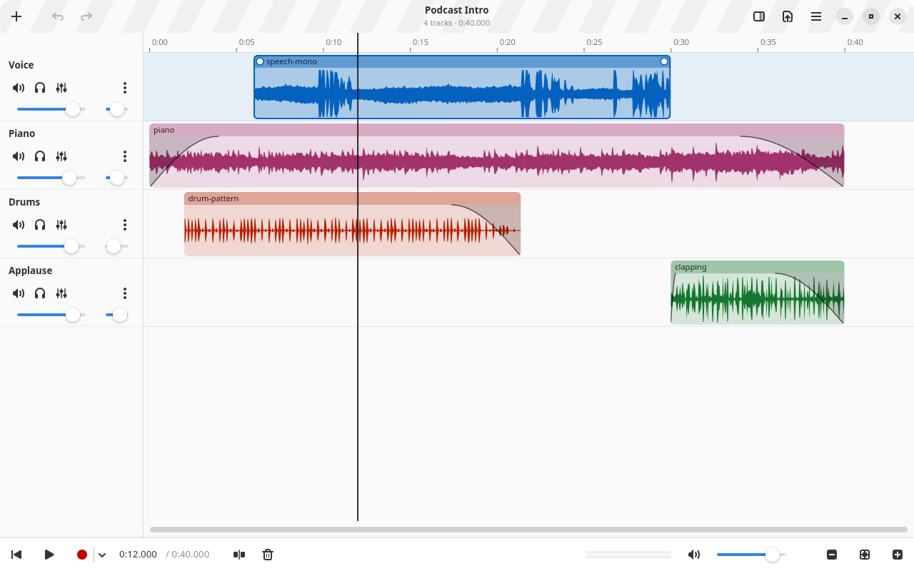

<div align="center">


# Transient

A simple multitrack audio editor for GNOME

[](https://github.com/sophiedkk/Transient/actions/workflows/ci.yml)
[](https://github.com/sophiedkk/Transient/releases/latest)
[](LICENSE)
[](https://apps.gnome.org/)

</div>

Put audio files on tracks, trim and arrange them, record over them, balance
their volume, and export the mix. Built with Rust, GTK 4, Libadwaita and
GStreamer.

<!-- GitHub shows the dark screenshot to readers who use a dark style. -->
<picture>
  <source media="(prefers-color-scheme: dark)" srcset="data/screenshots/main-window-dark.png">
  
</picture>

> **Status:** early development (0.3). You can import or record audio,
> arrange, trim and cut it on tracks, give tracks a colour, add fades, mix the
> tracks and export the result; see [`ROADMAP.md`](ROADMAP.md) for what comes next.

## Install

Download a file from the [latest release](https://github.com/sophiedkk/Transient/releases/latest):

- **Flatpak** (any distribution with Flatpak): `flatpak install --user
  Transient-0.2.0.flatpak`. It fetches the GNOME runtime from Flathub by itself.
- **AppImage** (Fedora 43+, Ubuntu 26.04+, Arch, openSUSE Tumbleweed): make it
  executable (`chmod +x Transient-0.2.0-x86_64.AppImage`) and start it.

## The name

In audio, a *transient* is the short, sharp burst at the start of a sound: the
crack of a snare drum, the "t" in "test", the moment a string is plucked. They
are what you look for when you cut audio, and the tall white bar in the middle
of the icon is one. The icon's light blue, pink and white come from the
transgender pride flag, which the name nods to as well.

## How Transient is made

Transient is largely written by an AI coding agent: **Claude Opus 5.5**, by
Anthropic, used through **Claude Code**. That covers most of the Rust code and
its tests, the build and packaging files (Meson, the Flatpak manifests, the
AppImage script and the CI workflows), the app icon and the documentation.

I decide what Transient is and does: the development workflow, the features, 
how they work, and how they fit the GNOME guidelines. I steer each step, test the
app by hand, and read the parts of the code that matter most to me or that I am 
learning from; the rest I check by using the app.

Besides that, every change goes through automated checks: unit, property and
snapshot tests, strict lints (no warnings, no code that can crash the app),
dependency and licence checks, and scripted runs of the real app in an invisible
desktop, with screenshots and real key presses. CI repeats them on every push.

Commit messages describe changes, not the tools used to make them, so this
section is where the use of AI is recorded. Questions about it are welcome in
the [issues](https://github.com/sophiedkk/Transient/issues).

## Development

Development happens inside a [Toolbx](https://containertoolbx.org/) container, so
nothing has to be installed on your system except Podman, Toolbx and Flatpak
(all included in Fedora Workstation). The container is self-contained: it holds
the libraries, the Rust version pinned in `rust-toolchain.toml`, and the test
and dependency-check tools.

### First-time setup (on the host)

```sh
dev/setup.sh
```

This builds the `transient-dev` image from [`dev/Containerfile`](dev/Containerfile)
(Rust included) and creates the toolbox. After changing `dev/Containerfile`,
`dev/packages.txt` or `rust-toolchain.toml`, run `dev/setup.sh --rebuild`; the
script also says so when the toolbox's Rust no longer matches.

### RustRover

RustRover runs normally on the desktop; only the Rust tools run in the toolbox,
where GTK, GStreamer, Blueprint and Rust itself are installed. `dev/toolbox-bin/`
holds small wrappers (`cargo`, `rustc`, `rustup`, `rustfmt`, …) that do that.

1. Open `~/Projects/Transient` in RustRover.
2. *Settings → Rust → Toolchain location*: the `dev/toolbox-bin` folder of this
   repository, as a full path (RustRover does not expand `~`), e.g.
   `/home/you/Projects/Transient/dev/toolbox-bin`; `dev/setup.sh` prints it.
   *Standard library*: `~/.cache/transient-dev/rust-src-1.97.1`, as a full path
   too (`dev/setup.sh` copies it there and prints it: RustRover cannot see the
   Rust inside the container). Decline offers to download a toolchain.
3. *Settings → Rust → External Linters*: **Clippy**, run on the fly.
   *Settings → Rust → Rustfmt*: use rustfmt, run on save.
4. Run the app with a Cargo configuration: command `run -p transient`,
   environment `GSETTINGS_SCHEMA_DIR=target/gschemas` (after one `just run`, so
   the schema is compiled). Files to open go after a separate `--`:
   `run -p transient -- test-audio/piano.flac`. RustRover builds in the
   toolbox, then starts the app on the desktop, using the desktop's GTK and
   GStreamer.
5. In RustRover's terminal, `toolbox enter transient-dev` first, then `just …`.

### Everyday work (inside the toolbox)

```sh
toolbox enter transient-dev
just run        # build and start Transient
just test       # run the tests
just check      # everything CI checks: format, clippy, tests, cargo-deny, metadata
just fix        # fix formatting and the lints clippy can fix automatically
just flatpak    # build, install and run the Flatpak
```

Test audio (free licences, from Wikimedia Commons) is downloaded with
`dev/fetch-test-audio.sh` into `test-audio/`; `just test-audio` decodes all of it.

### Without a window

```sh
just run test-audio/piano.flac                  # open a file directly
just probe test-audio/*                         # decode files, print JSON
just screenshot test-audio/piano.flac           # save target/screenshot.png
just headless --silent --play --quit-after=3 test-audio/drum-loop.wav
```

`just headless` and `just screenshot` run Transient in an invisible GNOME compositor,
which is handy for testing and for AI-assisted development. `transient --help` lists
the command-line options.

`just` without arguments lists all recipes.

### Project layout

| Path | What it is |
|---|---|
| `crates/transient-core` | Project model and audio maths. No GTK or GStreamer, so everything is unit-tested. |
| `crates/transient-engine` | Audio input and output with GStreamer: decoding, playback, export. |
| `crates/transient-cli` | `transient-cli`: the engine on the command line (JSON output). |
| `crates/transient` | The GTK app. UI layouts are Blueprint files in `resources/ui/`. |
| `data/` | Desktop file, AppStream metainfo, icons and the GSettings schema. |
| `po/` | Translations. |
| `build-aux/` | Flatpak manifest and Meson helper script. |
| `dev/` | Toolbx image, setup and test scripts, release scripts, and the `toolbox-bin` wrappers for RustRover. |

Dependencies point one way: `transient` and `transient-cli` → `transient-engine` →
`transient-core`.

## License

[MIT](LICENSE)
